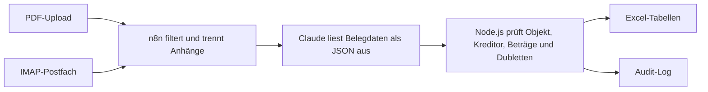

# Rechnungsverarbeitung mit n8n, Claude und Excel

Der Workflow liest Rechnungen, Gutschriften und Abrechnungen aus PDF-Dateien. Er ordnet jeden Beleg einem verwalteten Objekt zu, prüft Beträge und Dubletten und schreibt die Ergebnisse in eine lokale Excel-Arbeitsmappe. Im Audit-Log steht, was mit jedem Beleg passiert ist und wann eine manuelle Prüfung nötig ist.

## Ablauf



| Prüfung | Verhalten |
| --- | --- |
| Objektzuordnung | Vergleicht die Objekt- oder Verbrauchsstelle mit den Stammdaten. Unbekannte Objekte landen im Audit-Log. |
| Rechenprüfung | Vergleicht Positionssummen, Umsatzsteuer und Brutto. Abweichungen führen zum Status **Klärung**. |
| Kreditorabgleich | Sucht nach USt-ID, IBAN oder Name. Namensabgleiche und neue Kreditoren werden zur Prüfung markiert. |
| Dublettenprüfung | Prüft Kreditor und Rechnungsnummer sowie den Fingerabdruck der PDF. Erneut eingereichte Belege werden als **Dublette** protokolliert. |
| Gutschriften und sonstige Schreiben | Erfasst Gutschriften mit negativen Beträgen und protokolliert sonstige Schreiben als **Kein Beleg**. |

Die Arbeitsmappe enthält die Tabellen **Objekte**, **Einheiten**, **Kreditoren**, **Rechnungen**, **Rechnungspositionen** und **Audit_Log**. Ein Audit-Eintrag enthält unter anderem Dateiname, Herkunft, Ergebnis, Prüfhinweis und Laufzeit in Sekunden. Zeitstempel in der Arbeitsmappe verwenden UTC.

## Lokal starten

Voraussetzungen sind **Node.js ab Version 22**, **npm** und **n8n**. Die Compose-Datei enthält die verwendete n8n-Version. Auf macOS ist das Setup für Docker Desktop vorgesehen.

```bash
npm ci
docker compose up -d
npm start
```

Der Excel-Dienst lauscht auf `127.0.0.1:5680` und legt beim ersten Start `data/rechnungen.xlsx` sowie das lokale Verbindungstoken unter `data/private/bridge-token` an. Öffne anschließend n8n unter [localhost:5678](http://localhost:5678).

### Demo mit Beispieldaten

1. Importiere [den Demo-Workflow](workflows/02-demotest.json) in n8n.
2. Lege ein **Header Auth**-Credential an. Der Header heißt `X-Belege-Token`, der Wert steht in `data/private/bridge-token`. Wähle dieses Credential im Knoten **Demo pruefen und speichern**.
3. Starte den Workflow manuell. Die Excel-Datei findest du unter `data/demo-rechnungen.xlsx`.

Die Demo verarbeitet acht synthetische Ereignisse. Sie zeigt unter anderem eine Dublette, eine Gutschrift, ein unbekanntes Objekt und einen Auslesefehler. Dafür ist kein Claude-Konto erforderlich.

### Eigene PDFs verarbeiten

1. Importiere [den Hauptworkflow](workflows/01-rechnungsverarbeitung.json). Wähle im Knoten **Claude API** ein Anthropic-Credential mit Zugriff auf das im Knoten **Claude Anfrage** konfigurierte Modell. Wähle im Knoten **Pruefen und Excel schreiben** das lokale Header-Auth-Credential.
2. Trage in `data/rechnungen.xlsx` unter **Objekte** eine Objekt-ID, Straße, Hausnummer, PLZ und Ort ein. Setze den Status auf `aktiv`. Speichere und schließe Excel vor der Verarbeitung.
3. Starte **PDF hochladen** im Testmodus und lade eine PDF hoch. Öffne nach dem Lauf die Blätter **Rechnungen** und **Audit_Log**.

Die HTTP-Knoten nutzen unter Docker Desktop `host.docker.internal:5680`. Läuft n8n direkt auf demselben Rechner, verwende stattdessen `127.0.0.1:5680` in den jeweiligen Knoten. Für den E-Mail-Eingang kannst du **Spaeter Mail-Eingang** mit einem separaten IMAP-Testpostfach verbinden, den Knoten aktivieren und den Workflow veröffentlichen. E-Mails ohne PDF werden übersprungen.

Ist die Excel-Datei beim Schreiben geöffnet, speichert der Dienst den Vorgang zur Wiederholung. Schließe die Datei und führe [den Wiederholungsworkflow](workflows/03-excel-wiederholung.json) mit demselben Header-Auth-Credential aus. Der Dienst verwendet dafür die gespeicherte Ausleseantwort.

## Tests

```bash
npm test
```

Die 45 automatisierten Tests prüfen die Beleglogik und den Weg vom lokalen HTTP-Endpunkt bis zur gespeicherten XLSX-Datei. Dafür verwenden sie synthetische Eingaben und ein temporäres Verzeichnis.

Im ursprünglichen n8n-Praxistest wurden fünf anonymisierte PDFs in zwei Durchläufen mit der Claude API verarbeitet. Der erste Lauf schrieb vier Buchungsbelege mit 13 Positionen. Der zweite protokollierte vier Dubletten. Das Informationsschreiben erschien in beiden Läufen als **Kein Beleg**.

## Projektstruktur

| Pfad | Inhalt |
| --- | --- |
| [`workflows/`](workflows/) | Importierbare Exporte für PDF-Verarbeitung, Demo und Wiederholung |
| [`Server/schema.mjs`](Server/schema.mjs) | JSON-Schema und Ausleseanweisung |
| [`Server/engine.mjs`](Server/engine.mjs) | Objektzuordnung, Rechenprüfung und Dublettenlogik |
| [`Server/workbook.mjs`](Server/workbook.mjs) | Excel-Tabellen und Formatierung mit ExcelJS |
| [`Server/server.mjs`](Server/server.mjs) | Lokale HTTP-Verbindung, Schreibsperre und Wiederholung |

Für die Veröffentlichung verwendet die Excel-Anbindung die öffentlich installierbare Bibliothek ExcelJS und erzeugt ihre eigene Vorlage. Workflow-Exporte enthalten keine Zugangsdaten. Dateien unter `data/` sind für den lokalen Betrieb vorgesehen. PDFs aus dem Hauptworkflow werden zur Auslesung an die Claude API übertragen.
