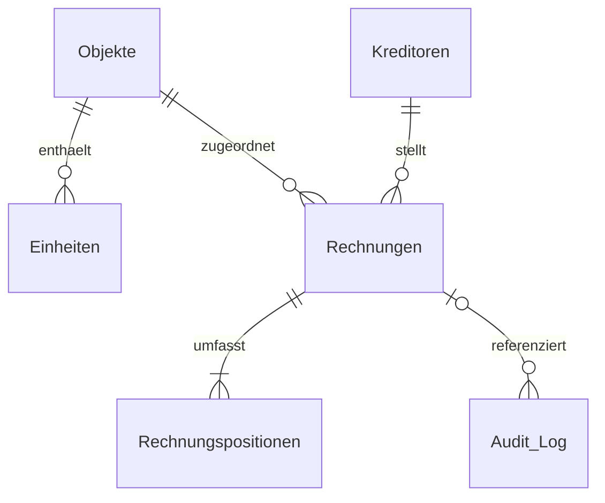

# Datenmodell

Die lokale Arbeitsmappe enthält sechs Blätter mit jeweils einer benannten Excel-Tabelle. Das Prüfprogramm liest die vorhandenen Zeilen ein und entscheidet daraus, ob es Stammdaten, einen Buchungsbeleg oder ausschließlich einen Audit-Eintrag ergänzt. Die Spaltennamen und Prüfregeln stehen in [der Beleglogik](../Server/engine.mjs). Die Reihenfolge und Formatierung der Spalten legt [der Excel-Adapter](../Server/workbook.mjs) fest.

## Tabellen

| Tabelle | Eine Zeile beschreibt | Kennungen und wichtige Daten |
| --- | --- | --- |
| `Objekte` | Ein verwaltetes Gebäude | `ObjektID`, Bezeichnung, Verwaltungsart, Adresse, Straße, Hausnummer, PLZ, Ort und Status |
| `Einheiten` | Eine Einheit innerhalb eines Objekts | `EinheitID`, `ObjektID`, Bezeichnung, Lage, Nutzungsart, Wohnfläche und MEA |
| `Kreditoren` | Einen Rechnungsaussteller | `KreditorID`, Name, Adresse, USt-ID, IBAN, Status und Anlagezeitpunkt |
| `Rechnungen` | Eine Rechnung, Gutschrift oder Abrechnung | `RechnungID`, `KreditorID`, `ObjektID`, Rechnungsnummer, Datum, Netto, USt, Brutto, Fälligkeit und Prüfstatus |
| `Rechnungspositionen` | Eine Leistungsposition eines Buchungsbelegs | `PositionID`, `RechnungID`, Positionsnummer, Beschreibung, Menge, Einheit, Einzelpreis, Nettobetrag, Steuersatz und Kategorie |
| `Audit_Log` | Das Ergebnis einer Belegverarbeitung | `AuditID`, Herkunft, Mail-ID, Dateiname, Ergebnis, ausgelesene Werte, Probleme, Prüfhinweis und gegebenenfalls zugeordnete IDs |

Beim ersten Start erzeugt der Dienst eine leere Arbeitsmappe. Objekt- und Einheitendaten werden für den eigenen Anwendungsfall ergänzt. Der Demo-Endpunkt verwendet eigene synthetische Stammdaten. Die aktuelle Belegverarbeitung ordnet Rechnungen einem Objekt zu. Eine Verteilung der Kosten auf einzelne Einheiten ist kein Verarbeitungsschritt des Codes.

## Beziehungen

Ein Objekt kann mehrere Einheiten und mehrere Rechnungen haben. Ein Kreditor kann mehrere Rechnungen ausstellen. Jede erfasste Position verweist über `RechnungID` auf ihren Buchungsbeleg. Ein Beleg kann in mehreren Audit-Zeilen vorkommen, etwa nach einer neuen Zustellung als Dublette. Audit-Zeilen zu Fehlern, unbekannten Objekten oder allgemeinen Schreiben können ohne `RechnungID` bestehen.

Die Zuordnung erfolgt über die gespeicherten IDs. Die Tabellen werden nicht über ihre Excel-Zeilennummer verbunden. Der Adapter ergänzt die lesbare Rechnungsnummer auch in der Positionstabelle. Excel erzwingt für diese Verknüpfungen keine Datenbank-Fremdschlüssel.

## Rechnungsnummer und interne IDs

Die **Rechnungsnummer** stammt vom Aussteller und wird aus dem PDF übernommen. Eine Nummer wie `DEMO-R-001` kann bei verschiedenen Kreditoren vorkommen. Für die fachliche Dublettenprüfung wird deshalb die Kombination aus `KreditorID` und normalisierter Rechnungsnummer verwendet.

Die **internen IDs** verbinden die Tabellen innerhalb der Arbeitsmappe.

| Kennung | Entstehung im Code |
| --- | --- |
| `ObjektID` und `EinheitID` | Werden mit den Stammdaten eingetragen |
| `KreditorID` | Bei Neuanlage `K-` mit einem gekürzten SHA-256-Hash einer verwendbaren USt-ID, IBAN oder des normalisierten Namens |
| `RechnungID` | `R-` mit einem gekürzten Hash aus `KreditorID` und normalisierter Rechnungsnummer |
| `PositionID` | `RechnungID` mit einem Suffix wie `-P001` für die erste Position |
| `AuditID` | `A-` mit einem gekürzten Hash aus Postfach beziehungsweise Upload-Herkunft, Nachrichten- oder Upload-ID, Anhangsindex, Dateiname und PDF-Fingerabdruck |

IDs, Rechnungsnummern und Bankverbindungen werden als Text gespeichert. So bleiben etwa führende Nullen erhalten. Der vollständige SHA-256-Wert unter `PDF_SHA256` dient zusätzlich dazu, denselben PDF-Inhalt wiederzuerkennen. Die Bildung der Kennungen ist in [der Beleglogik](../Server/engine.mjs) implementiert.

## Ergebnisse der Verarbeitung

Ein allgemeines Schreiben wird als `Kein Beleg` protokolliert. Für einen Buchungsbeleg vergleicht die Objektprüfung die ausdrücklich ausgewiesene Objekt- oder Verbrauchsstelle mit der Objektliste. Die Rechnungsadresse einer Verwaltung belegt dabei keinen Leistungsort. Bei fehlender oder mehrdeutiger Zuordnung entsteht `Objekt unbekannt` im Audit-Log. In diesem Fall werden keine Rechnung, Positionen oder neuen Kreditoren angelegt.

Erfolgreich erfasste Belege erhalten das Audit-Ergebnis `Geschrieben`. Die Rechnung kann zugleich den Status `Klärung` haben, zum Beispiel wegen eines neuen Kreditors, fehlender Pflichtfelder oder einer Rechenabweichung. `Pruefung_ok` beschreibt die Pflichtfeld- und Rechenprüfung. Eine bestandene Zahlenprüfung und die noch offene Kontrolle neuer Kreditorstammdaten sind daher gleichzeitig möglich.

Gutschriften erhalten negative Rechnungs- und Positionsbeträge. Bei Abrechnungen werden bereits gezahlte Abschläge und der verbleibende Zahlbetrag getrennt vom Gesamtbrutto gespeichert. Nettobeträge, Steuer und Brutto sind Zahlen. Der API-Prozentwert `19` wird für eine Position als `0.19` gespeichert und in Excel als `19,0 %` angezeigt.

## Dublette und idempotente Wiederholung

Eine **neue Zustellung** einer bereits erfassten Rechnung erhält eine neue Quellenkennung. Findet die Prüfung denselben Kreditor und dieselbe Rechnungsnummer oder denselben PDF-Fingerabdruck, entsteht ein zusätzlicher Audit-Eintrag mit `Dublette`. Er verweist auf die vorhandene Rechnung. Rechnung, Positionen und Kreditor werden nicht erneut angelegt. Nummern mit abweichenden Satzzeichen und abweichende Beträge beim gleichen Beleg werden zusätzlich zur manuellen Prüfung markiert.

Eine **Wiederholung desselben Ereignisses** behält dagegen seine Quellenkennung und damit dieselbe `AuditID`. Ist dieses Ereignis bereits erfolgreich verarbeitet, liefert das Programm das vorhandene Ergebnis zurück. Der Vorgang ist idempotent und erzeugt keine zusätzliche Audit-Zeile. Das schützt beispielsweise vor einem doppelten Schreiben bei einer technischen Wiederholung.

Ein vorhandener Audit-Eintrag mit `Fehler` oder `Objekt unbekannt` kann nach einer Korrektur erneut geprüft werden. Der Code ersetzt dann die betreffende Audit-Zeile, statt sie ein zweites Mal anzulegen. Der [Wiederholungsworkflow](../workflows/03-excel-wiederholung.json) verarbeitet lokal gespeicherte offene Schreibvorgänge.
